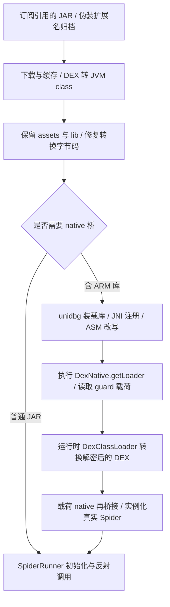

# WinBox JAR 与 native 执行链核查

核查基准是项目固定的 WinBox 提交
136fadcacb2b3a9bd96320578d93e9735452d9e9；下列原始实现与该提交没有差异。
这是源码核查，未安装或运行 WinBox 的 native 依赖，不能作为 Linux/NAS
或当前真实订阅的 native 执行成功证据。

WinBox 已实现我们缺少的核心链路：ARM 模拟执行、native 方法改写、JNI 宿主
绑定，以及解密后 DEX 的再次转换和加载。它有 native 桥和 shell-shim 两条路径。

## 1. 下载、转换和资源保留

入口是 src/engine/spider/JarSpiderBridge.ts 的 doConvertStage（约 600 行）。
它下载归档、运行 dex2jar，并在收尾阶段检查产物至少含 class。
finalize 路径（约 978 行）会：

- 把原归档的 assets/lib 等非 DEX 资源搬回产物；保护壳需要 .so 和 .guard。
- 调用 DexJarRepair 修复 R8 构造器与 NEW 类型转换错误。
- 用 classFix.ts 修复错误的自递归 super 调用。
- 原子发布转换结果，并保留缓存/进行中状态。

resources/jvm/tools/JarRewriter.java 另有重算栈帧工具；但当前实际 jvmPrefix
仍传入 -noverify（JarSpiderBridge.ts 约 2012 行）。不能从该工具的注释推断
整个运行链已启用 JVM 校验。

## 2. native 主链路

JarSpiderBridge.ts 的 ensureNativeRuntime（约 1777 行）按需准备
unidbg 0.9.9、ASM、Dynarmic/Unicorn2 等依赖，并把桥及工作目录传给 JVM。
源码列出 18 个运行期包，日志估计约 39 MB；本次未下载或验证这些二进制。

resources/jvm/SpiderRunner.java 的 setupEnv（约 314 行）先用临时 loader
完成 native 改写，再创建正式 loader，补丁目录排在蜘蛛 JAR 前。正式 loader
建好后会重新绑定桥。蜘蛛 JAR 不进入运行时父 classpath，避免父加载器先加载
未改写类。宿主 Application 与 Init 在实例化 Spider 前完成初始化。

resources/jvm/native-bridge/com/winbox/nativebridge/NativeBridge.java：

- initWithSo（205 行）提取并识别 ELF，建立 ARM32 或 AArch64 模拟器，设置
  AndroidResolver(23)、JNI 和资产模块，装载 .so 并执行 JNI_OnLoad。
- 扫描 JNI 注册表和 Java_ 导出符号，建立 native 方法调用计划。
- backendFactory（351 行）优先 Dynarmic，可切换/回退 Unicorn2。
- invoke（428 行）在模拟器锁内封送参数并调用真实 ARM 函数。
- 外层壳与 ARM32 载荷有不同的 VM/锁；64 位载荷可以进入外层 VM。

NativePatcher.java 的 patch / patchPayload 把 native 方法改写成
NativeBridge.invoke / invokePayload，并处理 System/Runtime.load 调用。
已由桥执行的注册入口可以成为空方法；业务 native 通过模拟器执行。
运行时载荷的 load(path) 转交 bridgeLoad，动态库另走 dynamic 路径。

因此 WinBox 没有让桌面 JVM 直接加载 ARM ELF；实际 ARM 指令由模拟器执行。

## 3. 解密后的代码仍有下一层加载

resources/jvm/stubs-src/dalvik/system/BaseDexClassLoader.java：

- 按内容识别裸 DEX 或 DEX 归档，包括 .db/.bin 等伪装文件名。
- dexToJar（266 行）转换、缓存和修复运行时 DEX。
- patchRuntime（105 行）给载荷 JAR 的 native/load 调用继续打补丁。
- 注册新 loader，使 native JNI 回调能找到载荷中的 InitOrigin 等真实类。

EnvJni / BridgeClassFactory 提供 Context、ClassLoader、资产和对象代理。
PosixFile / BridgeFileSystem 把来宾 POSIX 路径映射到工作目录下的 rootfs。
Context.getClassLoader 与壳 Init.classLoader 的对象绑定必须一致；只补同名
方法不够。BridgeARM32Emulator 还补充了载荷可能需要的 Go/Linux 系统调用。

## 4. shell-shim 备用路径

resources/jvm/stubs-src/shell-shim/com/github/catvod/spider/DexNative.java
用纯 Java 影子类提供 getLoader/getSpider。前提是已经提供真实 Spider 的
JAR/目录，而不是只有加密 .guard 文件。

JarSpiderBridge.ts 的 autoShellShim（1307 行）按 guard 名寻找
shell-shim/real/<guard>.jar，也支持 TVBOX_SHELL_SHIM_CLASSES。
shimWithFoni 对 AppSx/AppTT/AppSK 等类还有指定实现优先级。
这说明成功运行可能同时依赖运行时模拟和预先取得的真实实现，不能把影子类
当作通用解密器，也不能假定公开源码附带所有这些真实实现产物。

## 5. 对 Linux 移植的结论

当前 backend 已有普通 DEX 转换、资源保留、动态加载和受控保护初始化；
真实订阅 45 个 CSP 共用的 JAR 含 ftyguard_v7.so / ftyguard_v8.so 和 guard
载荷，当前在 native admission 阶段拒绝。WinBox 的 native 主链路正好对应
这项缺口，应以它为参考建立受控执行桥，再用实际 getLoader/getSpider 验证。

接入顺序：

1. 固定 unidbg/ASM 与模拟后端的版本、哈希和许可，验证目标 Linux x86_64
   的宿主 native 后端；Windows 的 java.exe、分号 classpath、盘符路径需适配。
2. 接入 NativeBridge、NativePatcher、JNI/classloader/asset/rootfs 绑定。
   初版可为每个 native JAR 使用独立 worker，以隔离桥的全局静态状态。
3. 接上现有 DexArtifacts/BaseDexClassLoader，验证解密 DEX、载荷 JNI 回调和
   native 依赖；需要转换修复时使用真实失败样本建立对照。
4. 检查 getLoader 非空、返回 loader 可加载真实类、getSpider 可初始化与调用，
   再验证退出、超时、rootfs/临时文件清理和 Android/ART 行为。

WinBox 的桌面兼容处理也会改变行为：SpiderRunner 强制部分 merge.cn.yq
分支，shell-shim 中 HideUtils 有占位行为；payloadLoad 会跳过指定 Go 代理库；
Build/包名是桌面 stub 值；启动使用 -noverify。它们需要与固定 Android 基准
逐项对照，不能直接成为本项目的行为规范。

本次仅新增核查文档。没有安装工具、下载运行期、启动服务或变更启动项。
